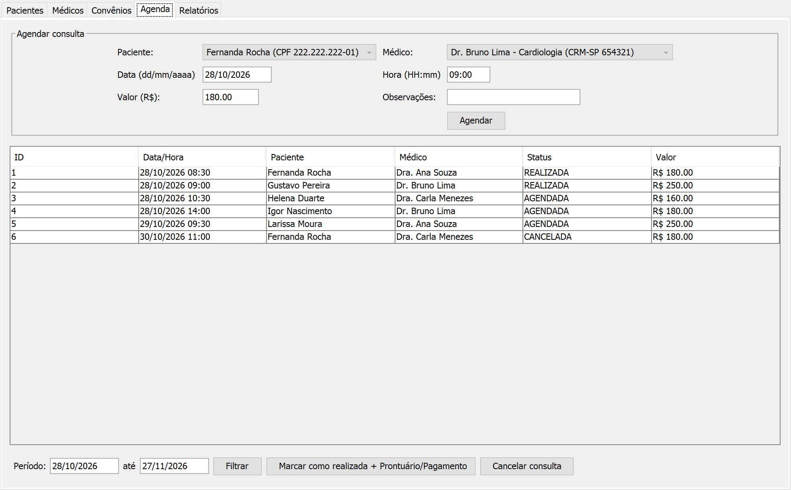
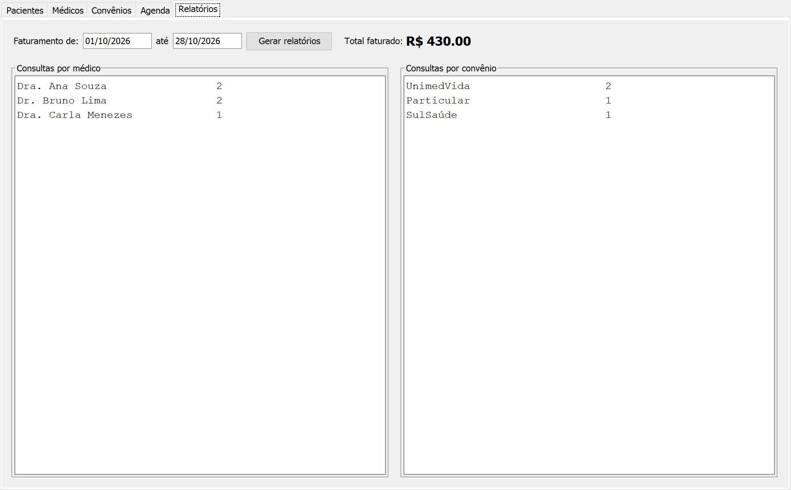

# Clínica Vida

Sistema desktop para clínicas e consultórios: pacientes, médicos, convênios, agenda de consultas, prontuário, pagamentos e relatórios. **A agenda não deixa marcar duas consultas para o mesmo médico no mesmo horário.** Feito em Java com Swing, MySQL e JDBC.




| Tentando marcar no horário ocupado | Relatórios |
| :---: | :---: |
|  |  |

*Pacientes e CPFs de exemplo.*

## O que este projeto mostra

- **Regra que evita erro da recepção:** antes de agendar, `ConsultaDAO.existeConflito` confere se o médico já tem consulta naquele horário, e o banco reforça com `UNIQUE (medico_id, data_hora)`.
- **Fluxo completo do atendimento:** a consulta nasce agendada; depois é marcada como realizada (com prontuário e pagamento) ou cancelada.
- **Relatórios com dados agrupados:** faturamento no período, consultas por médico e por convênio.
- **Organização em camadas:** `model`, `dao` (com `PreparedStatement`, o que protege contra SQL Injection), `ui` e `util`.

## Contexto

Muitos consultórios ainda controlam a agenda em papel ou planilha, o que leva a horários marcados duas vezes, histórico de atendimento perdido e recepção lenta. O Clínica Vida centraliza a operação: a recepção cadastra pacientes e convênios, agenda com o médico certo, e ao fim do atendimento registra prontuário e pagamento no mesmo lugar.

## Funcionalidades

- **Pacientes:** nome, CPF, nascimento, telefone, e-mail e convênio (opcional).
- **Médicos:** nome, CRM e especialidade.
- **Convênios:** nome e valor da consulta.
- **Agenda:** marca consulta com paciente, médico, data, hora e valor; filtra por período; bloqueia conflito de horário.
- **Atendimento:** marca a consulta como realizada, registrando prontuário (diagnóstico e prescrição) e pagamento, ou cancela a consulta.
- **Pagamento:** dinheiro, cartão, Pix ou convênio.
- **Relatórios:** total faturado no período, consultas por médico e por convênio.

## Estrutura

```text
sql/schema.sql            # cria o banco clinica_vida, as tabelas, convênios e médicos de exemplo
src/
├── Main.java
├── config.properties.example
├── model/                # Paciente, Medico, Convenio, Consulta, Prontuario, Pagamento, StatusConsulta, FormaPagamento
├── dao/                  # um DAO por entidade + RelatorioDAO
├── ui/                   # TelaPrincipal e as abas: Pacientes, Médicos, Convênios, Agenda, Relatórios
└── util/ConexaoFactory.java
```

| Tabela | Conteúdo |
| :--- | :--- |
| `paciente` | Dados pessoais, CPF (único) e convênio. |
| `medico` | Nome, CRM (único) e especialidade. |
| `convenio` | Nome e valor da consulta. |
| `consulta` | Paciente, médico, data e hora, status (agendada, realizada, cancelada), valor e observações. Um médico não pode ter duas consultas no mesmo horário. |
| `prontuario` | Diagnóstico e prescrição de uma consulta. |
| `pagamento` | Valor, forma de pagamento e data de uma consulta. |

## Como rodar

Pré-requisitos: JDK 17+, MySQL 8 e o driver [MySQL Connector/J](https://dev.mysql.com/downloads/connector/j/) (`.jar`).

1. Rode `sql/schema.sql` no MySQL. Ele cria o banco `clinica_vida`, as tabelas, três convênios e três médicos.
2. Copie `src/config.properties.example` para `src/config.properties` e preencha usuário e senha do seu MySQL.
3. Rode pela IDE (adicione o `.jar` do Connector/J às bibliotecas e execute `Main.java`) ou pelo terminal, com o `.jar` numa pasta `lib/`:

```bash
cd src
javac -d ../out -cp ".:../lib/mysql-connector-j.jar" $(find . -name "*.java")
cp config.properties ../out/
cd ../out
java -cp ".:../lib/mysql-connector-j.jar" Main
```

No Windows, troque `:` por `;` no `-cp`.

## Roteiro rápido de teste

1. Cadastre um paciente (médicos e convênios já vêm no script).
2. Na aba Agenda, marque uma consulta.
3. Tente marcar outra para o mesmo médico no mesmo horário: o sistema avisa e bloqueia.
4. Marque a consulta como realizada, preencha prontuário e pagamento.
5. Na aba Relatórios, escolha o período e gere os relatórios.

| Erro | Solução |
| :--- | :--- |
| `ClassNotFoundException: com.mysql.cj.jdbc.Driver` | O `.jar` do Connector/J não está no classpath (pasta `lib/` ou bibliotecas da IDE). |
| `Access denied for user` | Usuário ou senha errados no `config.properties`. |
| `Public Key Retrieval is not allowed` | Acrescente `&allowPublicKeyRetrieval=true` na `db.url`. |
| `Communications link failure` | O MySQL não está ligado. |
